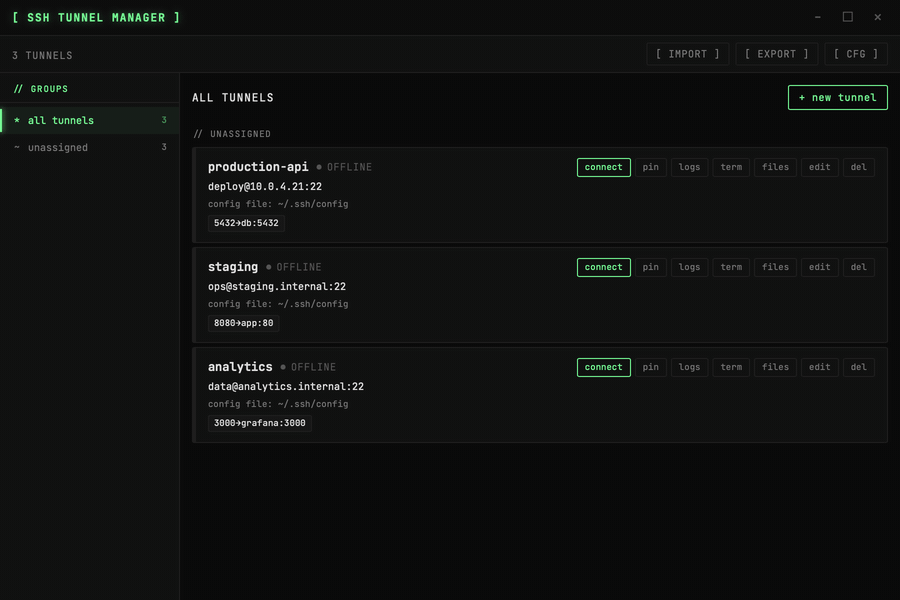
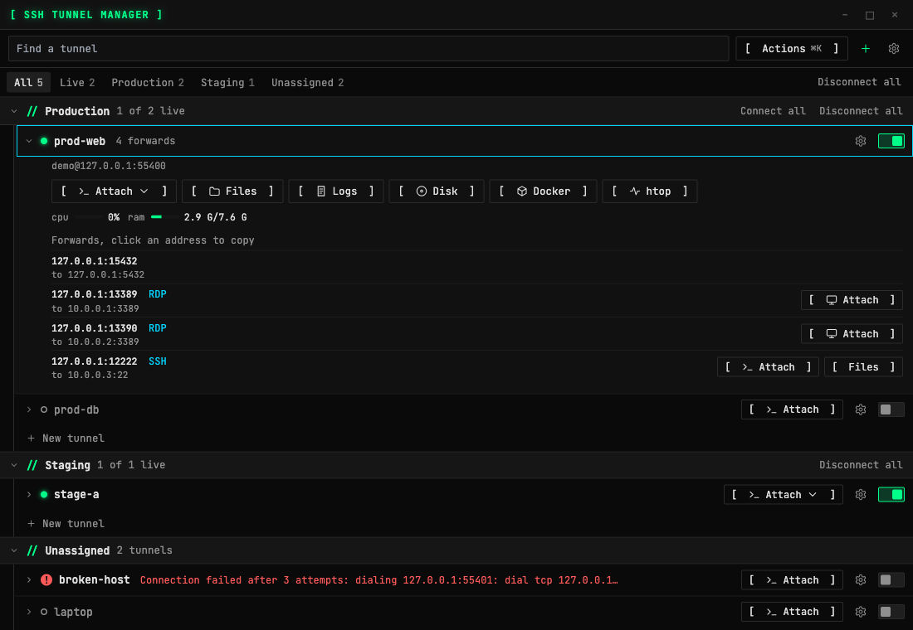
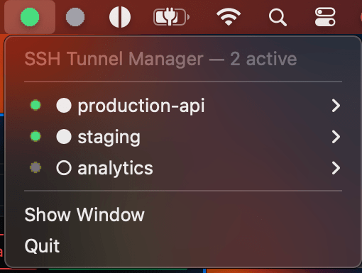
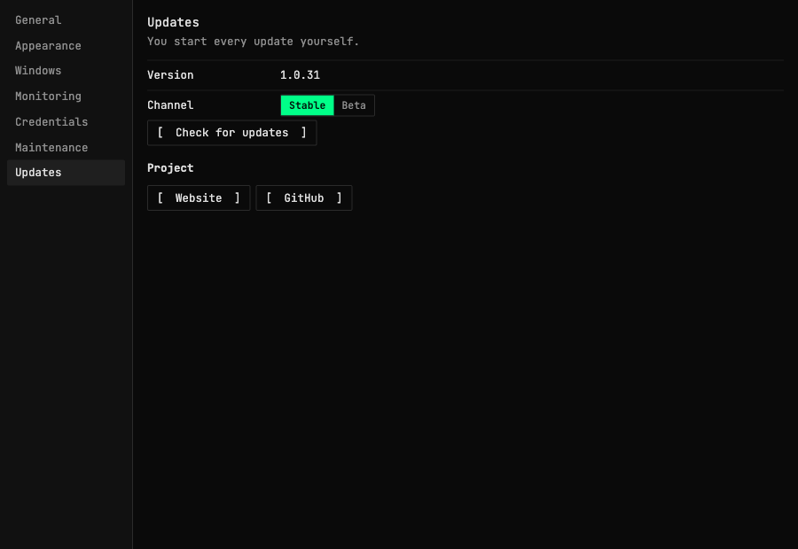

# SSH Tunnel Manager



SSH tunnels and server tools in one app for Windows, macOS and Linux: tunnels, terminal, files, Docker and server stats. It works on your existing `~/.ssh/config`. Tunnels are stored as standard `Host` blocks, so `ssh` and `git` see the same entries.

[Website](https://justcodepl.github.io/ssh-tunnel-manager/) · [Download](https://github.com/JustCodePL/ssh-tunnel-manager/releases/latest) · [Which one to use](https://justcodepl.github.io/ssh-tunnel-manager/compare/)

Built with Go + [Wails 3](https://wails.io) + Svelte. Ships as a single binary (Windows: NSIS installer).

## Features

- **System tray first** — connect, disconnect, and copy port addresses without opening a window
- **Pure-Go SSH** — no dependency on an installed `ssh` binary
- **Port forwarding** — multiple local→remote mappings per tunnel, with one-click clipboard copy from the tray
- **Key authentication** — RSA, ECDSA, Ed25519 key files or a running `ssh-agent`; encrypted keys prompt for a passphrase once and store it in the OS keychain
- **ProxyCommand / ProxyJump** — full support for bastion hosts
- **Tool windows** — terminal, files, Docker, processes, disk, logs and remote desktop open in their own windows, which can sit on any screen; how they group into tabs is a setting
- **Attach** — one button opens a session; it shows a menu only when a tunnel offers more than one, such as a terminal and a remote desktop
- **Credentials** — named RDP and VNC logins saved in the OS keychain and reusable across tunnels and forwards
- **Host key verification** — every connection checks the server against `~/.ssh/known_hosts` and the keys you accepted in the app. An unknown server shows its fingerprint and connects only after you trust it; a changed key stops the connection
- **Saved logins** — one login for SSH and remote desktops, in the system keychain. A tunnel with a saved SSH login tries its key and agent first, and sends the password only after the server's host key is verified. A jump host never receives it and needs its own key or the agent
- **Shared clipboard** — text, pictures and files between your computer and a remote desktop, with a direction setting per tunnel. Tested with GNOME Remote Desktop. xrdp 0.9.12 does not exchange pictures, and Windows has not been tested yet
- **Per-tunnel settings** — what a row shows, refresh intervals, clipboard and what happens after a disconnect can each be overridden on one tunnel
- **Command palette** — `⌘K` or `Ctrl+K` finds tunnels and runs actions; the list works from the keyboard
- **Built-in remote desktop** — RDP is detected on connected hosts and opens in the app, through the SSH connection, with no external client (no remote audio). Only the default port, 3389, is checked unless you set another one under the host's advanced options
- **Actions on forwards** — a forward can be typed `rdp` or `ssh`, inferred from ports 3389 and 22, which adds a remote desktop, terminal or file browser button that opens on the forward's target, for example a machine behind a bastion
- **Groups** — organise tunnels into named groups with Connect All / Disconnect All
- **Import from SSH config** — parse `~/.ssh/config` and import selected hosts in one step
- **Export to SSH config** — write selected tunnels back to a standard SSH config file
- **Connection retries** — a tunnel that can't connect is retried up to 3 times, then stops and shows the error in the app
- **Start on login** — optional autostart via Windows registry / macOS Launch Agent / Linux `.desktop` entry
- **OS keychain** — passphrases stored in Windows Credential Manager, macOS Keychain, or Linux Secret Service
- **Terminal** — an interactive shell on the connected host, with a tab per session
- **File browser** — browse remote files over SFTP: upload, create folders, download folders as ZIP, edit text files, rename and delete
- **Disk usage** — mounted filesystems and their usage on the host
- **CPU/RAM** — live host load for a connected tunnel, in its panel or in its row
- **Process monitor and Docker** — the `htop` button (shown only when the host has `htop` installed) opens the app's own process monitor with load, CPU per core, memory and a sortable process list; the `docker` button (shown only when Docker is installed) lists containers with status, image and ports
- **Logs** — per-tunnel connection log with warnings and reconnects
- **Auto-update** — checks GitHub Releases on startup; download and install from the Settings panel or the tray menu; choose the *Stable* or *Beta* channel

| Connected tunnels | Tray menu | Settings |
|---|---|---|
|  |  |  |

## Works with your existing `~/.ssh/config`

- Tunnels already defined in `~/.ssh/config` are loaded on first launch.
- Every tunnel you add is saved as a standard `Host` block, so `ssh`, `git` and other tools can use it too.
- App-only settings (port forwards, groups, colours, auto-connect) live in comments inside the block, so other SSH clients ignore them.
- Import from and export to any SSH config file. There is no proprietary format to migrate away from.

## Download

Get the latest release from the [Releases page](https://github.com/JustCodePL/ssh-tunnel-manager/releases).

| Platform | File | Notes |
|----------|------|-------|
| Windows | `ssh-tunnel-manager-amd64-installer.exe` | NSIS installer, recommended |
| Windows | `ssh-tunnel-manager-windows-amd64.zip` | Portable `.exe`, no installer |
| macOS | `ssh-tunnel-manager-darwin-arm64.dmg` | Disk image (Apple Silicon) |
| macOS | `ssh-tunnel-manager-darwin-amd64.dmg` | Disk image (Intel) |
| Linux | `ssh-tunnel-manager-linux-amd64.tar.gz` | Standalone binary |

## Installation

**Windows** — run the NSIS installer. It places the app in `Program Files`, creates a Start Menu entry, and registers an uninstaller.

**macOS** — open the DMG and drag `SSH Tunnel Manager.app` to `/Applications`. The app is signed with an Apple Developer ID and notarized by Apple, so it opens without a security override. Since v1.1.0 the notarization ticket is stapled to the app itself, so the first launch also works without an internet connection.

**Linux** — extract the binary to `~/.local/bin/` or `/usr/local/bin/` and run it. For autostart, enable *Start on login* in Settings.

#### Portless mode on privileged ports

Portless forwards reach a service over a `*.ssh-local` domain instead of a `127.0.0.1:port` pair. Ports below `1024` need platform-specific authorization while the main application remains unprivileged.

**macOS 13+** registers a signed, machine-wide Portless service through Apple's ServiceManagement framework. Approve SSH Tunnel Manager once in System Settings → General → Login Items & Extensions; the service then restores the resolver, `lo0` aliases, and the narrowly scoped PF anchor at every boot for every macOS account. Public ports `1–1023` on `127.0.1.0/24` are translated to private listener ports `10001–11023` while preserving each domain's loopback IP. The GUI always remains unprivileged. You can inspect, refresh, or remove the service in the app's Settings panel. Older macOS versions retain the legacy per-setup authorization path.

**Windows** binds the requested Portless port directly and needs no additional low-port authorization.

**Linux** requires the `CAP_NET_BIND_SERVICE` capability on the binary when a forward binds a privileged port. Unprivileged processes are otherwise denied with `bind: permission denied`.

On macOS, Settings → Maintenance shows whether Portless has a problem, and can repair or remove its service. The same page has the app log and details for a bug report.

On Linux you have two ways to grant it:

- **In-app (recommended).** The first time a privileged-port portless forward fails to bind, a banner appears with an **[ AUTHORIZE ]** button. Clicking it runs `pkexec setcap` and you approve the PolicyKit dialog once. Linux only applies a file capability at process start, so the banner then offers **[ RESTART NOW ]** — after the restart the forward binds normally.
- **Manually.** Run the command shown in the banner (and logged), pointing at your installed binary:

  ```sh
  sudo setcap 'cap_net_bind_service=+ep' ~/.local/bin/ssh-tunnel-manager
  ```

> **Re-apply after updates.** Capabilities are an attribute of the binary's inode, so an in-app update that replaces the binary drops the capability. The updater detects this and tries to restore it automatically (you may see one more PolicyKit prompt); if that fails — e.g. on a headless box without `pkexec` — the next failed bind shows the banner again with the exact `setcap` command.
>
> Distro packagers installing to a system path can ship `build/linux/pl.justcode.ssh-tunnel-manager.policy` to `/usr/share/polkit-1/actions/` for a friendlier authorization prompt.

## Usage

### System Tray

The tray icon is the primary interface. Left-click opens the manager window; right-click shows the context menu.

The icon colour indicates aggregate tunnel state:
- **Grey** — all tunnels disconnected
- **Green** — at least one tunnel connected
- **Red** — at least one tunnel in error state

Tunnels that have a colour assigned show coloured dots overlaid on the icon.

Each tunnel entry in the menu has a submenu with Connect / Disconnect and all local port addresses. Clicking a port address copies `127.0.0.1:<port>` to the clipboard.

When an update is available, an **⬆ Update to vX.Y.Z** item appears above the separator at the bottom of the menu.

### Manager Window

Open via the tray left-click or *Show Window*. From here you can:

- Add, edit, or delete tunnels
- See live status badges (Connecting / Connected / Error / Disconnected)
- Import tunnels from an SSH config file
- Export selected tunnels to an SSH config file

In **Settings → Startup**, *Start on login* enables OS autostart. *Start
minimized on login* is enabled by default so the app stays in the system tray
without taking focus after sign-in; disable it to open the manager window
automatically instead.

### Adding a Tunnel

Click **+**, choose **Tunnel** and fill in:

| Field | Description |
|-------|-------------|
| Name | Friendly label shown in the tray and window |
| Host | SSH server hostname or IP |
| Port | SSH port (default 22) |
| User | SSH username |
| Key file | Path to your private key (`.pem`, `id_ed25519`, etc.) |
| Group | Optional group name for organising tunnels |
| Color | Optional hex colour for the tray dot indicator |
| Auto-connect | Connect this tunnel automatically on app start |
| Port forwards | One or more `localPort → remoteHost:remotePort` mappings |
| ProxyCommand | e.g. `ssh -W %h:%p bastion` |
| ProxyJump | e.g. `user@bastion.example.com` |

### Authentication

The app uses public-key authentication. It tries, in order: the key in the *Key file* field, a running `ssh-agent` (`SSH_AUTH_SOCK`; on macOS also the launchd agent socket, on Windows the OpenSSH agent pipe), and — when no key file is set — the default keys `~/.ssh/id_ed25519`, `id_ecdsa` and `id_rsa`. If a key is passphrase-protected, you will be prompted once per session; the passphrase is then stored in the OS keychain so subsequent launches are seamless.

### Limitations

- Local port forwarding only: no SOCKS (`-D`) and no remote forwards (`-R`) yet.
- Password and keyboard-interactive logins are not supported.
- `IdentityAgent` from `~/.ssh/config` is not read yet; the agent is found through `SSH_AUTH_SOCK` or the platform default.

### Auto-Update

On every startup the app silently checks GitHub Releases. The update channel can
be selected in **Settings → Updates**:

- **Stable** (default) receives full releases only
- **Beta** receives prereleases as well as full releases, so a beta installation
  automatically advances to the final stable build when it is published

Switching from Beta back to Stable automatically installs the newest full stable
release, even when its version is lower than the currently installed beta. The
stable build replaces the beta in place and restarts only after the old process
has exited. A single-instance lock prevents both channels from running side by
side.

If a newer version is found:

- A blue dot appears on the Settings gear icon in the manager window
- An **⬆ Update to vX.Y.Z** item appears in the tray menu
- A banner appears in **Settings → Updates**

Click **Install & Restart** (or the tray item) to download the installer and apply the update. The app quits automatically so the installer can replace the binary. On Windows, the NSIS installer runs silently in the background.

## Configuration

Tunnels are stored directly in your **`~/.ssh/config`** file as standard `Host` blocks. This means:

- Tunnels you add in the app are immediately visible to `ssh`, `git`, and any other tool that reads SSH config.
- Tunnels already in `~/.ssh/config` are loaded automatically on first launch.
- The file is plain text — you can hand-edit it at any time; the app re-reads it on the next operation.

App-specific metadata (port forwards, groups, colours, auto-connect) is stored as comments inside each `Host` block so it round-trips cleanly without breaking other SSH clients.

Passphrases are **never** written to disk; they go to the OS keychain (Windows Credential Manager / macOS Keychain / Linux Secret Service).

## Development

### Prerequisites

- Go 1.26+
- Node.js 22+
- **Linux only**: `sudo apt install libgtk-4-dev libwebkitgtk-6.0-dev` (GTK 4 and WebKitGTK 6.0, so a recent distribution)
- **Windows installer builds**: [NSIS](https://nsis.sourceforge.io/)
- To regenerate the frontend bindings after changing bound methods: `go install github.com/wailsapp/wails/v3/cmd/wails3@v3.1.0`, then `wails3 generate bindings -ts -d frontend/bindings`

### Running in dev mode

```bash
git clone https://github.com/JustCodePL/ssh-tunnel-manager
cd ssh-tunnel-manager
(cd frontend && npm ci && npm run build)
go run .
```

### Running tests

```bash
go test ./...                       # unit and integration tests
cd frontend
npm run check                       # types
npm test                            # frontend unit tests
npx playwright install chromium     # once
npm run test:e2e                    # the real backend and frontend against a fake SSH server
```

All of these run in CI and block a release. Each release build also starts the real app on its platform and fails if a window's frontend cannot reach the backend.

### Linting

```bash
golangci-lint run ./...
```

## Building

```bash
# arch is amd64 or arm64. macOS gets an app bundle, Linux a binary, and
# Windows the portable exe and the NSIS installer.
scripts/build-app.sh amd64
```

Output lands in `build/bin/`.

### Version

Local builds use `wails.json → info.productVersion`. Release builds inject the
full tag version into the application and keep the operating-system package
version numeric for Windows and macOS.

To publish a stable release:

1. Commit the release changes
2. Create an annotated tag such as `v1.1.0`. Use the first line of the tag
   message as the GitHub Release title, followed by a blank line and the release
   notes.
3. Push the tag: `git push origin v1.1.0`

To publish a beta release, use an annotated SemVer prerelease tag:

```bash
git tag -a v1.1.0-beta.1 \
  -m "Portless reliability and startup improvements" \
  -m "- Preserve automatic Portless forwards
- Explain server-side forwarding blocks"
git push origin v1.1.0-beta.1
```

The first paragraph becomes the per-version title shown on GitHub and on the
project site. The remaining paragraphs become the release description. Releases
without a custom title fall back to `Beta release`, `Latest stable release`, or
`Stable release` on the English site and their Polish equivalents.

Subsequent betas increment the suffix (`beta.2`, `beta.3`, …). Promote a tested
beta by tagging the chosen commit with the matching stable version, for example
`v1.1.0` after `v1.1.0-beta.3`.

GitHub Actions accepts only `vMAJOR.MINOR.PATCH` and
`vMAJOR.MINOR.PATCH-beta.N`, builds all platform artifacts, and marks beta tags
as GitHub prereleases without replacing the latest stable release.

## Project Structure

```
├── app.go                  # Wails-exposed methods (Go ↔ frontend bridge)
├── version.go              # Version variable, embedded from wails.json
├── main.go                 # Wails bootstrap
├── app_toolwindow.go       # Native tool windows
├── app_settings.go         # App and per-tunnel settings
├── app_credentials.go      # Saved logins
├── internal/
│   ├── ssh/                # Pure-Go SSH connections and port forwarding
│   ├── config/             # JSON persistence and data models
│   ├── tray/               # System tray icon, badge, menu
│   ├── windows/            # Which tool is open in which window and tab
│   ├── clipboard/          # Pictures on the system clipboard
│   ├── updater/            # GitHub Releases update checker + platform installers
│   ├── autostart/          # Platform autostart (registry / launch agent / .desktop)
│   ├── keychain/           # OS keychain storage for passphrases and logins
│   └── sshconfig/          # SSH config file parser and writer
├── frontend/src/
│   ├── App.svelte           # The main window
│   ├── ToolApp.svelte       # A tool window and its tabs
│   ├── components/          # TunnelList, TunnelRow, TunnelForm, tool views, …
│   ├── tools/               # Settings windows and the frame around a tool
│   ├── lib/                 # Logic without UI, unit tested
│   └── stores/              # Svelte stores (tunnels, settings)
└── build/
    ├── windows/installer/   # NSIS scripts
    └── darwin/              # macOS plist files
```

## License

MIT — see [LICENSE](LICENSE) for details.
